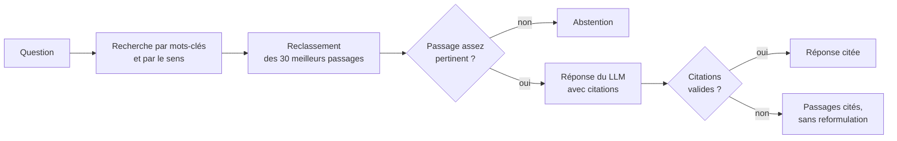

# RAG fiscal

Un assistant qui répond aux questions de fiscalité patrimoniale à partir de la doctrine officielle (le BOFiP),
qui cite le passage exact derrière chaque réponse, et qui dit « je ne sais pas » quand il n'est pas sûr.

## Pourquoi ce projet

J'ai passé un an à la DGFiP, dans le service qui exploite les données fiscales pour choisir les dossiers à
contrôler. J'y ai vu à quel point la doctrine fiscale est dense, et à quel point une réponse approximative peut
coûter cher.

Un conseiller en gestion de patrimoine qui s'interroge sur l'IFI ou sur une donation n'a pas besoin d'une réponse
brillante. Il a besoin d'une réponse juste, avec la référence du texte pour pouvoir vérifier. J'ai voulu
construire un RAG qui tient cette promesse, et surtout mesurer s'il la tient vraiment.

## Ce que fait l'outil

On lui pose une question en français. Il cherche dans 949 documents du BOFiP (revenus de capitaux mobiliers,
IFI, successions et donations, revenus fonciers), garde les cinq passages les plus pertinents, puis rédige une
réponse dont chaque phrase renvoie à l'un d'eux.

Deux situations le poussent à ne pas répondre normalement :

- **Aucun passage n'est assez pertinent** : il s'abstient et le dit clairement.
- **Le LLM ne répond pas, ou cite une source qui n'existe pas** : l'API renvoie directement les passages
  trouvés, avec leurs références.

## Comment ça marche



**Le découpage.** Le BOFiP est organisé en paragraphes numérotés (10, 20, 30...). Je découpe sur ces numéros,
pour ne jamais couper une règle en deux, et j'ajoute le titre du document en tête de chaque passage, pour qu'il
reste compréhensible seul.

**La recherche.** Deux recherches tournent en parallèle dans Qdrant : l'une par mots-clés (BM25), l'autre par le
sens du texte (embeddings multilingual-e5). Leurs classements sont fusionnés, puis un second modèle relit les 30
meilleurs candidats pour ne garder que les cinq plus pertinents. On peut aussi filtrer par impôt ou par date.

**La génération.** Le LLM ne voit que ces cinq passages, numérotés, et doit citer `[n]` après chaque affirmation.
Les consignes (prompts) sont versionnées, et deux versions peuvent être comparées en A/B : chaque
utilisateur reste affecté à la même version pendant tout le test. Gemini et toutes les API compatibles OpenAI sont pris en charge.

**Le service.** Une API FastAPI, avec une clé par client : chaque client ne voit que les documents publics et
les siens. Les métriques partent vers Prometheus et Grafana, avec des alertes (trop d'abstentions, LLM
indisponible, latence), et chaque requête est tracée avec OpenTelemetry.

## Ce que j'ai appris en le construisant

**Mon premier découpage était faux.** Dans les données publiées, chaque numéro de paragraphe est seul sur sa
ligne, et mon découpage les rattachait au mauvais passage. Je ne l'ai vu qu'en ouvrant les vrais documents.

**La recherche par mots-clés est redoutable sur ce sujet.** Le vocabulaire fiscal est précis (« abattement »,
« micro-foncier », « nue-propriété »), et la recherche par mots-clés seule retrouve le bon document parmi les cinq
premiers pour 96 % des questions. La recherche hybride ne l'a pas battue sur mon jeu de test. Je la garde parce
qu'elle devrait mieux résister aux questions mal formulées, mais il me faut un jeu de questions reformulées pour
le prouver.

**Le reclassement change tout.** Sans lui, le bon document arrive en tête pour 46 % des questions ; avec lui,
pour 71 %. C'est l'étape qui compte le plus, puisque le LLM s'appuie d'abord sur les premiers passages.

**Les contraintes réelles décident de l'architecture.** Le quota gratuit de Gemini est de 20 requêtes par jour :
l'évaluation de la génération se fait donc sur un échantillon, et seulement à la demande. Ma première évaluation
a tourné 30 minutes sur le processeur d'un serveur de CI : j'ai raccourci les textes analysés et mis l'index en
cache pour les suivantes.

**Le seuil d'abstention se mesure, il ne se devine pas.** Le meilleur passage obtient un score médian de 0,98
pour les questions du périmètre, contre 0,02 pour les questions hors sujet. J'ai fixé le seuil à 0,6 d'après ces
mesures.

## Résultats

24 questions annotées à la main sur les documents, plus 8 questions hors périmètre (TVA, impôt sur les sociétés,
cuisine...). Le rapport complet est régénéré par la CI : [eval/REPORT.md](eval/REPORT.md).

| Configuration | Bon document en tête | Dans les cinq premiers | MRR |
|---|---|---|---|
| Sens du texte seul | 38 % | 83 % | 0,58 |
| Mots-clés seuls | 54 % | 96 % | 0,68 |
| Les deux, fusionnés | 46 % | 92 % | 0,64 |
| **Les deux, puis reclassement** | **71 %** | **92 %** | **0,79** |

Ces chiffres ont leurs limites. 32 questions suffisent pour comparer des réglages, pas pour annoncer une
performance générale, et le seuil d'abstention a été calibré sur ces mêmes questions. La latence, autour de
3 secondes avec reclassement, est mesurée sur le processeur d'un serveur de CI : un serveur Qdrant et un GPU la
réduiraient fortement.

## Le lancer

Sans LLM, l'API renvoie les passages cités. Les modèles sont téléchargés au premier lancement :

```bash
pip install -r requirements-dev.txt -r requirements-ml.txt
uvicorn rag_fiscal.api.main:app --app-dir src
curl -s localhost:8000/ask -H 'Content-Type: application/json' \
  -d '{"question": "Quel abattement s'\''applique à la résidence principale pour l'\''IFI ?"}'
```

Avec un LLM et la supervision complète (Qdrant, Prometheus, Grafana, Jaeger) :

```bash
cp .env.example .env              # renseigner RAG_LLM_PROVIDER et RAG_LLM_API_KEY
docker compose up -d qdrant
docker compose run --rm api python scripts/build_index.py
docker compose up -d              # API :8000, Grafana :3000, Prometheus :9090, Jaeger :16686
```

Les tests tournent sans modèle ni réseau : `pytest -q`

## Ce qu'il reste à faire

- Un jeu d'évaluation plus large, avec des questions reformulées, et un jeu distinct pour calibrer le seuil.
- Mesurer la fidélité des réponses générées, au-delà de la vérification des citations.
- Placer une authentification OIDC (Keycloak, par exemple) devant l'API.
- Étendre le corpus au reste de la doctrine.

Ce n'est pas un outil de conseil fiscal : il aide à retrouver la doctrine applicable.

## Comment je l'ai construit

J'ai développé ce projet avec Claude Code, utilisé comme binôme de programmation. Le code est couvert par des
tests et une intégration continue, et l'évaluation tourne automatiquement à chaque modification.

```
src/rag_fiscal/
  ingest/      chargement du corpus et découpage
  index/       embeddings, BM25 et index Qdrant
  retrieve/    reclassement des résultats
  generate/    prompts versionnés, citations, abstention
  api/         API FastAPI
scripts/       téléchargement du BOFiP, construction de l'index
eval/          questions annotées, évaluation, rapport
monitoring/    Prometheus, Grafana, alertes
```

Données : BOFiP-Impôts, publications en vigueur, jeu de données public de
[data.gouv.fr](https://www.data.gouv.fr/datasets/bofip-impots-publications-en-vigueur).
